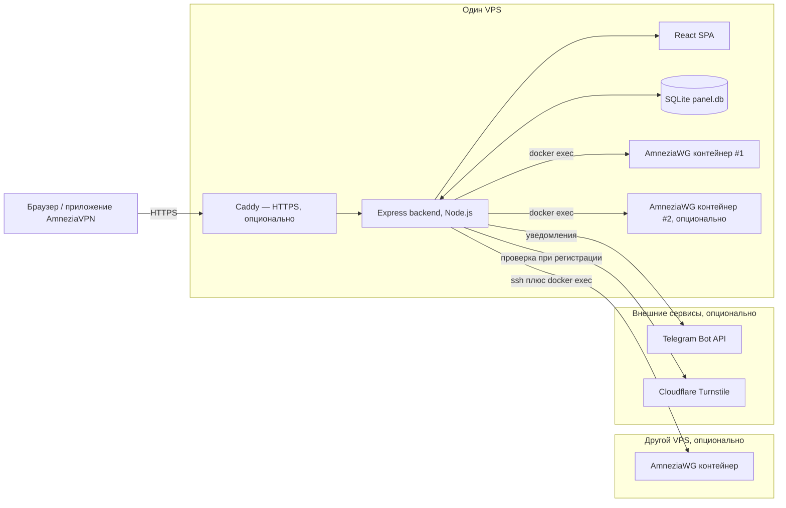
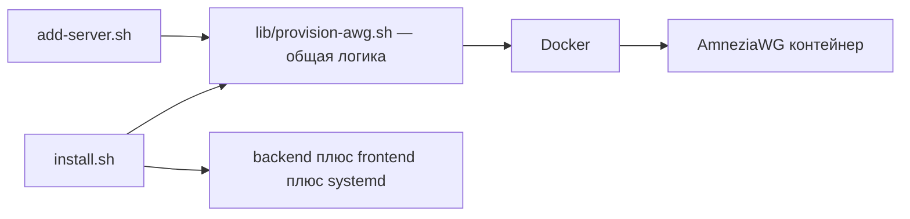
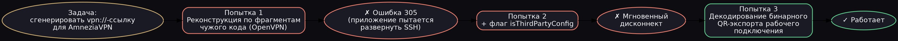
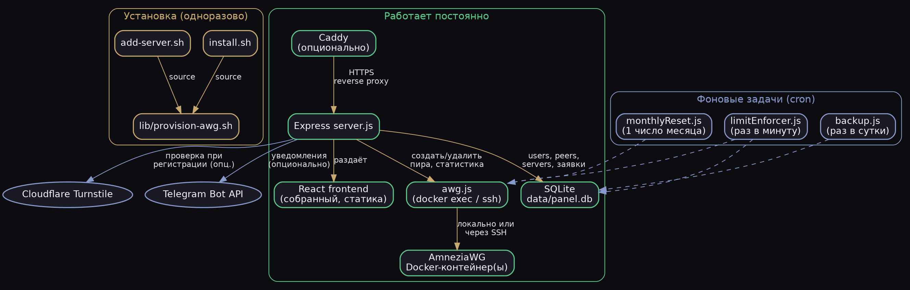

# Mr. Skdsh VPN

Полностью автономная self-hosted панель управления AmneziaWG-сервером —
альтернатива Marzban/3X-UI, но заточенная конкретно под протокол AmneziaWG
и приложение AmneziaVPN. Один VPS, ноль внешних сервисов.

Помимо AmneziaWG (2.0 и 3.1) панель умеет **VLESS + REALITY, Hysteria2 и Shadowsocks-2022** на движке Xray:
выберите протокол при создании сервера, панель сама всё установит и выдаст клиентам ссылки и QR.
Проверка перед запуском и обновление: [`docs/HARDWARE-CHECKLIST.md`](docs/HARDWARE-CHECKLIST.md), [`docs/UPGRADE.md`](docs/UPGRADE.md),
[`docs/SECURITY-AUDIT.md`](docs/SECURITY-AUDIT.md); автотесты: `tests/run-all.sh`.

Разворачивает VPN-сервер **без установки приложения Amnezia** и без SSH-доступа
со стороны клиентского приложения — всё делает один install-скрипт.


---

## Архитектура



**Установка — что от чего зависит:**



---

## Возможности

**Админ:**
- Список всех пользователей с живой статистикой трафика
- Создание доступа в один клик — ключи генерируются на сервере
- Лимиты трафика с автоматической ежемесячной обнулением (проверка раз
  в минуту — блокировка не мгновенная, на быстром интернете возможен
  небольшой перебор сверх лимита между проверками)
- Блокировка/удаление, переименование устройств
- Раздел заявок на подключение — одобрить/отклонить без единого SQL-запроса
- Сброс пароля любому пользователю без необходимости знать старый
- Ежедневное автоматическое резервное копирование базы
- Уведомления в Telegram о новых заявках и обращениях (опционально)
- Управление несколькими AmneziaWG-серверами из одной панели

**Клиент:**
- Логин/пароль (без email — саморегистрация тоже поддерживается)
- Датчик расхода трафика в реальном времени
- Несколько устройств под одним логином
- QR-код и файл конфига — **в двух форматах**: обычный WireGuard и
  нативная `vpn://`-ссылка для AmneziaVPN с человеческим именем сервера
- Запрос доп. устройства, обращения в поддержку — прямо в кабинете

**Инфраструктура:**
- SQLite вместо внешней БД — весь проект на одном VPS
- Своя авторизация (bcrypt + JWT), без сторонних auth-провайдеров
- Install-скрипт: Docker → AmneziaWG-контейнер → NAT/forwarding → backend →
  фронтенд → systemd → опционально Caddy с авто-HTTPS — всё одной командой
- Защита от подбора пароля, резервные копии, ежемесячный сброс лимитов

---

## Как это всё началось

Проект вырос из личной задачи: разобраться, почему у меня отвалился VPN,
поднятый через приложение AmneziaVPN на арендованном сервере. По ходу
разбирательств стало понятно, что для нескольких человек в семье удобнее
не гонять всех через одно приложение-администратор, а сделать нормальную
веб-панель — как Marzban, только под протокол AmneziaWG, который Marzban
не поддерживает.

## Генерация `vpn://`-ссылок для AmneziaWG

Приложение AmneziaVPN использует закрытый, нигде официально не
задокументированный формат ссылок для быстрого добавления сервера.
Панели нужно было научиться создавать такие ссылки самой — под каждого
нового пользователя, с его собственными ключами.



Реализация — в [`src/protocols/awg.js`](src/protocols/awg.js), функция `buildAmneziaVpnLink`.

**Важно:** этот проект не аффилирован с командой Amnezia и не использует
их код напрямую — только независимая реализация формата.

---

## Архитектура



---

## Установка на новый сервер

```bash
scp -r skdsh-panel root@ВАШ_IP:/opt/skdsh-panel
ssh root@ВАШ_IP
cd /opt/skdsh-panel
chmod +x install.sh
sudo ./install.sh
```

Скрипт спросит:
- Публичный IP сервера
- Порт WireGuard (по умолчанию 39001)
- Порт веб-панели (по умолчанию 3001)
- Домен для HTTPS (необязательно — без него доступ через SSH-туннель)
- Название сервера, которое увидят клиенты в приложении
- Логин/пароль администратора

И сам поставит Docker, Node.js, развернёт AmneziaWG (образ
`vernette/amneziawg`), настроит NAT/форвардинг трафика, соберёт фронтенд,
запустит всё как systemd-сервис, и при указанном домене — настроит Caddy
с автоматическим HTTPS через Let's Encrypt.

### Два режима установки

`install.sh` в начале спрашивает, как устанавливать:

1. **Всё на одном сервере** (по умолчанию) — панель и VPN вместе, как описано выше.
2. **Панель здесь, VPN за рубежом** — панель ставится на эту машину (например, на
   российский хостинг, чтобы она открывалась без VPN), а AmneziaWG разворачивается на
   зарубежном сервере по SSH. Docker на машине с панелью в этом режиме не нужен.

Что делает режим 2:
- создаёт **отдельный SSH-ключ** для панели (`/root/.ssh/skdsh_<IP>`) и ставит его на
  зарубежный сервер (пароль от сервера понадобится один раз). В `authorized_keys` ключ
  попадает с ограничениями `no-port-forwarding,no-agent-forwarding,no-X11-forwarding,no-pty`.
  Можно указать и свой готовый ключ;
- проверяет вход по ключу, Linux и права (для не-root нужен `sudo` без пароля);
- на зарубежном сервере ставит Docker, поднимает AmneziaWG (2.0 или 3.1 на выбор),
  включает пересылку пакетов (`net.ipv4.ip_forward`, сохраняется после перезагрузки),
  открывает порт в `ufw`, если он включён, и проверяет, что порт слушается;
- создаёт администратора и сам регистрирует зарубежный сервер в панели.

Панель ходит на сервер по SSH (порт 22) и держит соединение открытым, поэтому
операции с клиентами быстрые. Отпечаток сервера запоминается при первом подключении
(`StrictHostKeyChecking=accept-new`) и дальше проверяется.

Важно: SSH-ключ даёт панели root-доступ к VPN-серверу. Для дополнительной защиты
добавьте в `authorized_keys` на сервере ограничение по адресу панели:
`from="IP_ПАНЕЛИ",no-port-forwarding,... ssh-ed25519 ...`.

### Без домена — доступ через SSH-туннель

```bash
ssh -L 3001:localhost:3001 root@ВАШ_IP
```

Затем откройте `http://localhost:3001` в браузере.

---

## Стек

**Backend:** Node.js, Express, better-sqlite3, bcryptjs, jsonwebtoken, node-cron
**Frontend:** React 18, Vite, Framer Motion
**Инфраструктура:** Docker, AmneziaWG, Caddy

## Создать сервер прямо из панели

В разделе «Серверы» → «+ Добавить сервер» → вкладка **«Создать новый»**. Достаточно ввести
название, выбрать версию AmneziaWG (2.0 или 3.1) и указать, где развернуть:

- **На этой машине** — нужен публичный IP или домен, который увидят клиенты;
- **Другой сервер (SSH)** — IP и пользователь, а дальше на выбор: **«Создать ключ по паролю»**
  (панель сама создаст SSH-ключ и установит его на сервер) или **«Ключ уже есть»** (путь к
  приватному ключу без пароля, который уже установлен на том сервере, например созданному
  скриптом `add-server.sh`).

Панель сама подберёт имя контейнера, свободный порт и подсеть, сгенерирует ключи и параметры,
откроет порт в `ufw` (если он включён) и добавит сервер в список. В окне виден ход
развёртывания; если Docker не установлен, он поставится автоматически.

Как защищён пароль от сервера (режим «Создать ключ по паролю»): пароль нужен один раз, живёт только
в памяти панели на время запроса и **нигде не сохраняется**: ни в базе, ни в файлах, ни в журнале
(из журнала он вырезается, даже если бы попал). До `ssh` он доходит через переменную окружения и
временный скрипт-подсказку, который удаляется сразу после. Принимается только по HTTPS (через домен)
или через SSH-туннель на localhost, по обычному HTTP с чужого адреса панель откажет. Созданный
ключ лежит в `data/ssh/` (папка 700, файл 600) и ставится на сервер с ограничениями
`no-port-forwarding,no-agent-forwarding,no-X11-forwarding,no-pty`. Если пароль не подошёл,
созданный впустую ключ удаляется. Эти ключи не входят в ежедневные резервные копии базы, при
переносе панели на другую машину создайте ключ заново.

Устройство: панель проверяет ввод строгими шаблонами и запускает
[`lib/provision-cli.sh`](lib/provision-cli.sh) с параметрами через переменные окружения (в команду
оболочки ничего не подставляется). Одновременно идёт одно развёртывание; время ограничено
10 минутами. Вкладка «Подключить готовый» осталась для серверов, созданных не нашими скриптами.

## Несколько AmneziaWG-серверов

Панель умеет управлять несколькими AmneziaWG-серверами одновременно —
раздел "Серверы" в админке (добавление, редактирование, привязка пиров
к конкретному серверу). Два режима:

- **На этой же машине** — панель обращается к контейнеру через `docker
  exec` напрямую. На одном хосте можно поднять несколько независимых
  AmneziaWG-инстансов (разные порты, разные подсети, уникальные имена
  сетевых интерфейсов — иначе конфликт на уровне `--network host`)
- **Удалённый по SSH** — панель заходит на другой VPS по SSH и там уже
  выполняет `docker exec`. Требует SSH-ключ без пароля и root-доступ
  (или права на docker) на удалённой машине

Оба сценария разворачиваются одним скриптом —
[`add-server.sh`](add-server.sh) — он сам спрашивает, разворачивать
здесь или на другом сервере по SSH, и умеет **сразу зарегистрировать**
сервер в панели через API (спросит адрес панели и логин/пароль
администратора) — без ручного переноса значений в форму, хотя такой
вариант тоже доступен как запасной.

`install.sh` при первой установке тоже предложит развернуть
дополнительные серверы сразу же, в конце процесса — не обязательно
запускать `add-server.sh` отдельным шагом сразу после установки, хотя
он всегда доступен и для более поздних добавлений. Оба скрипта
используют общую логику разворачивания из [`lib/provision-awg.sh`](lib/provision-awg.sh),
чтобы не держать два места с одним и тем же кодом.

## Что не реализовано (сознательно, для первой версии)

- Email-уведомления — вместо этого Telegram-бот (см. `TELEGRAM_BOT_TOKEN`
  в `.env.example`); можно добавить и SMTP отдельным шагом, если нужно
- SSH-путь для удалённых серверов проверен только логически (генерация
  и синтаксис команд), без реального второго VPS под рукой — при первом
  использовании стоит протестировать на некритичном сервере

## Лицензия

MIT
